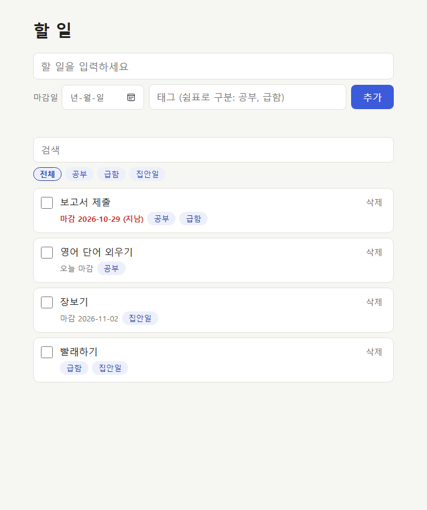
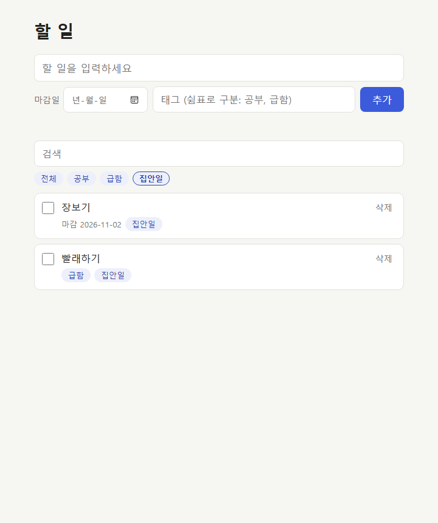

# AIFFEL Campus Agent Code Review Templete
- 개발자 : 강훈
- 리뷰어 : 한윤석

# ART 리뷰 — todoprd (Todo 앱)

- 대상: https://github.com/benjy89a/todoprd (커밋 `7a78453`, 2026-10-30, 에이전트(Claude)와 함께 작성)
- 리뷰 날짜: 2026-10-30
- 실행 환경: Windows 11, Node.js v24.11.1, 헤드리스 Microsoft Edge
- 원칙: **앱 코드는 수정하지 않았다.** 확인용 스크립트와 결과만 `review/` 폴더에 추가했다.

## 0. 이 앱은 무엇을 하나

내 컴퓨터에서만 돌리는 할 일(Todo) 웹앱이다. `npm start`로 서버를 켜고 브라우저에서 `http://localhost:3000`을 연다.

| 파일 | 하는 일 |
| --- | --- |
| `PRD.md` | 무엇을 만들지 적은 요구사항 (CRUD + 검색·마감일·태그, SQLite 저장, 비밀값은 .env) |
| `server.js` | Node 내장 기능(`node:http`, `node:sqlite`)만 쓰는 서버. 화면 파일을 보내고 `/api/...` 요청으로 DB를 읽고 쓴다. 입력값 검사도 여기서 한다 |
| `schema.sql` | DB 표 3개: `todos`(할 일), `tags`(태그), `todo_tags`(할 일↔태그 연결). 빈 제목·없는 날짜를 DB 단계에서도 막는다 |
| `public/index.html` | 화면 구조: 추가 폼(내용·마감일·태그), 검색창, 태그 필터, 목록 |
| `public/app.js` | 화면 동작: API를 불러 목록을 그리고, 추가·완료·삭제·검색·태그 필터를 처리한다 |
| `public/style.css` | 화면 꾸밈 (마감 지남은 빨간색, 완료는 줄긋기) |
| `.env.example` | 설정 예시 (`PORT`, `DB_PATH`). 비밀값은 없다 |

데이터 흐름: 브라우저(`app.js`) → `fetch('/api/todos')` → `server.js`가 입력 검사 → SQLite 파일(`todo.db`)에 저장 → JSON으로 응답 → 화면에 다시 그림.

---

## 1. 원하는 기능이 의도한 대로 동작하나요? — ✅ 통과

PRD의 기능을 헤드리스 브라우저로 실제로 조작해서 확인했다 (`node review/e2e-check.mjs`). 테스트용 DB는 임시 폴더에 따로 만들어서 실제 `todo.db`는 건드리지 않았다. 결과는 **11/11 통과**이다 (`review/e2e-result.json`).

| # | PRD 요구 | 확인한 것 | 결과 | 근거 화면 |
| --- | --- | --- | --- | --- |
| F1 | 목록 보기 | 처음엔 "할 일이 없어요." 안내 | ✅ | `review/screenshots/01-empty.png` |
| F2 | 추가 | 빈 내용으로 추가 → "할 일 내용을 입력하세요." | ✅ | `review/screenshots/02-empty-title-error.png` |
| F3 | 추가 + 마감일 + 태그 | 4개 추가, 마감 빠른 순·마감 없음은 뒤로 정렬 | ✅ | `review/screenshots/03-list-added.png` |
| F4 | 마감일 | 어제 마감은 "(지남)" 빨간색, 오늘은 "오늘 마감" | ✅ | `review/screenshots/03-list-added.png` |
| F5 | 태그 | 붙인 태그로 필터 칩(전체/공부/급함/집안일) 생성 | ✅ | `review/screenshots/03-list-added.png` |
| F6 | 완료 표시 | 체크하면 줄긋기 + 목록 맨 아래로 이동 | ✅ | `review/screenshots/04-done.png` |
| F7 | 검색 | "보고" 입력 → "보고서 제출"만 표시 | ✅ | `review/screenshots/05-search.png` |
| F8 | 검색 | 없는 말 검색 → "찾는 할 일이 없어요." | ✅ | — |
| F9 | 태그 | "집안일" 칩 → 장보기·빨래하기만 표시 | ✅ | `review/screenshots/06-tag-filter.png` |
| F10 | 삭제 | 삭제 확인창 표시 후 삭제됨 | ✅ | `review/screenshots/07-deleted.png` |
| F11 | 저장(껐다 켜도 남기) | 서버를 끄고 다시 켠 뒤 새로고침해도 목록 그대로 | ✅ | `review/screenshots/08-after-restart.png` |




**기능 면에서 아쉬운 점** (PRD 위반은 아님):
- 서버가 꺼져 있거나 요청이 실패하면 화면에 알림이 없다. 체크박스·삭제·목록 불러오기에 오류 처리가 없어서, 체크 표시는 됐는데 실제로는 저장이 안 된 상태가 될 수 있다 (`public/app.js:29`, `:43`, `:122`).
- 추가 버튼을 빠르게 두 번 누르면 같은 할 일이 두 번 생긴다.
- 완료한 일을 다시 "안 끝남"으로 돌리기는 되지만, 할 일 내용·마감일·태그를 **수정하는 기능은 없다**. PRD의 CRUD 중 U가 "완료 표시"로만 정의되어 있어서 요구사항 범위 안이다.

---

## 2. 보안 검토를 수행했나요? — ⚠️ 부분 통과

`node review/security-check.mjs`로 요청 17개를 보내 확인했다. **11/17은 기대대로 동작했고, 6개는 문제가 있었다** (`review/security-result.json`).

### 2-1. 민감 정보 하드코딩 — ✅ 없음
- 전체 git 기록(커밋 1개)에서 `password`, `secret`, `api_key`, `token`을 검색했고 0건이었다.
- 설정은 `.env`로 읽고, `.env`와 `*.db`는 `.gitignore`에 들어 있다. `.env.example`에는 `PORT`와 `DB_PATH`만 있다.
- PRD의 "비밀값은 .env로" 규칙을 지키고 있다.

### 2-2. 사용자 입력값 검증 — ✅ 대부분 잘 됨, ⚠️ 빈틈 3개

잘 된 것: 서버와 DB 양쪽에서 막는다.

| # | 보낸 값 | 응답 | 판정 |
| --- | --- | --- | --- |
| S1 | 빈 제목 `"   "` | 400 | ✅ |
| S2 | 제목 201자 | 400 | ✅ |
| S3 | 태그 11개 | 400 | ✅ |
| S4 | 태그 21자 | 400 | ✅ |
| S5 | 날짜 `2026/10/30` | 400 | ✅ |
| S6 | 없는 날짜 `2026-02-30` | 400 (DB의 CHECK 규칙이 막음) | ✅ |
| S7 | JSON이 아닌 본문 | 400 | ✅ |
| S8 | 10KB가 넘는 본문 | 400 | ✅ |
| S9 | `is_done: "yes"` | 400 | ✅ |
| S10 | XSS 문자열 `` | 글자 그대로 저장된다. 화면은 `textContent`로 그리므로 스크립트가 실행되지 않는다 | ✅ |
| S11 | 검색어 `' OR 1=1 --` (SQL 인젝션) | 0건. 모든 SQL이 prepared statement라 값이 SQL로 해석되지 않는다 | ✅ |

빈틈: 잘못된 입력인데 400이 아니라 **500(서버 오류)**이 난다. 서버가 죽지는 않지만, 입력 검사가 빠져 있다는 뜻이다.

| # | 보낸 값 | 응답 | 원인 |
| --- | --- | --- | --- |
| S12 | POST 본문이 `null` | 500 | `cleanNewTodo(null)`에서 `body.title`을 읽다 TypeError (`server.js:62`) |
| S13 | PATCH 본문이 `null` | 500 | `const { is_done } = null`에서 TypeError (`server.js:135`) |
| S14 | `due_date: ["2026-01-01"]` | 500 | 정규식 검사에서는 배열이 문자열로 바뀌어 통과한다. 그런데 SQLite에 넣을 때는 배열이라 오류가 난다 (`server.js:66-67`) |

### 2-3. 외부 접근 — ❌ 문제 있음

| # | 확인 | 결과 | 위험 |
| --- | --- | --- | --- |
| S15 | 다른 사이트(`Origin: https://evil.example`)가 `text/plain`으로 POST | **201 저장됨** | 사용자가 방문한 아무 웹사이트나 몰래 할 일을 추가할 수 있다(CSRF). 서버가 Content-Type을 확인하지 않는다 (`server.js:91`) |
| S16 | `Host: attacker.example`로 요청 | **200 목록 응답** | Host 헤더를 확인하지 않는다. DNS 리바인딩 공격으로 외부 사이트가 목록을 읽거나 지울 수 있다 |
| S17 | 같은 공유기의 LAN 주소(192.168.x.x)로 접속 | **200 접속됨** | `listen(PORT)`가 모든 네트워크에서 접속을 받는다 (`server.js:158`). 로그인이 없으므로 같은 와이파이의 누구나 할 일을 보고 지울 수 있다. "내 컴퓨터에서 도는 앱"이라는 PRD 의도와 맞지 않는다 |

### 2-4. 외부 데이터/의존성 — ✅ 위험 낮음
- `package.json`에 의존성이 **0개**이다. npm 패키지를 하나도 받지 않으므로 공급망 공격 위험이 없다.
- `node:sqlite`는 Node 내장 모듈이지만 아직 실험 단계(experimental)이다. 그래서 `npm start`가 경고를 끄는 옵션(`--disable-warning=ExperimentalWarning`)으로 실행한다. Node를 업데이트하면 API가 바뀔 수 있다는 점은 알고 있어야 한다.
- 외부 API나 CDN은 쓰지 않는다. 화면 파일도 전부 로컬에 있다.

### 개선 제안 (코드 수정은 하지 않았음)
1. `server.listen(PORT, '127.0.0.1')`로 바꿔 내 컴퓨터에서만 접속되게 한다 → S17 해결
2. POST/PATCH는 `Content-Type: application/json`만 받고, `Host`가 `localhost:PORT` 또는 `127.0.0.1:PORT`가 아니면 거절한다 → S15, S16 해결
3. `readJson` 결과가 객체가 아니면 400을 돌려주고, `due_date`는 `typeof === 'string'`인지 먼저 확인한다 → S12~S14 해결

---

## 3. 에러를 디버깅하여 "문제를 해결한 기록"을 남겼나요? — ❌ 저장소에는 없음

### 저장소 상태
- 커밋이 1개(`7a78453`)뿐이다. 완성된 코드가 한 번에 올라와서 **어떤 오류가 있었고 어떻게 고쳤는지 기록이 없다**.
- 테스트 코드, 실행 로그, 디버깅 노트, 이슈가 모두 없다.
- 코드 주석에는 이미 고친 흔적으로 보이는 부분이 있다. 하지만 어떤 문제를 겪었는지는 적혀 있지 않다.
  - `app.js:71`: 늦게 온 응답이 화면을 덮어쓰지 않게 하는 처리
  - `server.js:15`: 어느 폴더에서 실행해도 같은 DB를 쓰게 하는 경로 처리

### 이번 리뷰에서 남긴 기록 (문제 발견 → 원인 → 해결 방법)

| 단계 | 내용 |
| --- | --- |
| 발견 방법 | 코드를 읽고 의심스러운 곳을 찾은 뒤, 서버를 임시 DB로 띄워 그 입력을 직접 보냈다 (`curl` → `security-check.mjs`로 정리) |
| 문제 1 | `null` 본문과 배열 `due_date`에 500이 난다 (S12~S14). 서버 로그: `TypeError: Cannot read properties of null (reading 'title')`, `TypeError: Provided value cannot be bound to SQLite parameter 2.` |
| 원인 1 | `JSON.parse`는 객체 말고도 `null`, 숫자, 배열을 돌려줄 수 있는데 그 경우를 검사하지 않는다. 정규식 `.test()`는 받은 값을 문자열로 바꿔 검사해서 배열도 통과한다 |
| 문제 2 | 외부 사이트 요청과 LAN 접속이 허용된다 (S15~S17) |
| 원인 2 | 서버가 접속 주소를 지정하지 않았고 Content-Type·Host를 확인하지 않는다 |
| 해결 방법 | "2. 개선 제안" 1~3번 (사용자 결정에 따라 이번에는 코드를 고치지 않음) |
| 재확인 방법 | 고친 뒤 `node review/security-check.mjs`를 다시 돌려 17/17이 나오면 해결된 것이다 |
| 추가 실험 | 기능 11개를 브라우저로 자동 확인하는 `e2e-check.mjs`를 만들었다. 서버를 재시작하는 단계까지 넣어서 "껐다 켜도 남는다"는 요구를 실제로 확인했다 |

**제안:** 앞으로는 에이전트가 만든 코드에서 오류를 찾고 고칠 때마다 커밋을 나누고, 커밋 메시지에 "증상 / 원인 / 수정"을 적는다. 그러면 3번 항목의 근거가 자연스럽게 쌓인다.

---

## 요약

| 항목 | 판정 | 한 줄 |
| --- | --- | --- |
| 1. 기능 동작 | ✅ | PRD 기능 11개 모두 실제 화면에서 동작 확인 (스크린샷 8장) |
| 2. 보안 | ⚠️ | 비밀값·SQL 인젝션·XSS·의존성은 안전함. 입력 빈틈 3개와 외부 접근 문제 3개 발견 |
| 3. 디버깅 기록 | ❌ | 저장소에는 기록이 없음. 이번 리뷰에서 재현 스크립트와 원인 분석을 남김 |

## 다시 실행하는 법

```bash
node review/e2e-check.mjs
node review/security-check.mjs
```

둘 다 임시 폴더에 테스트용 DB를 따로 만들어서 쓰므로 실제 `todo.db`에는 영향이 없다. `e2e-check.mjs`는 Microsoft Edge가 기본 경로에 설치되어 있어야 한다.
